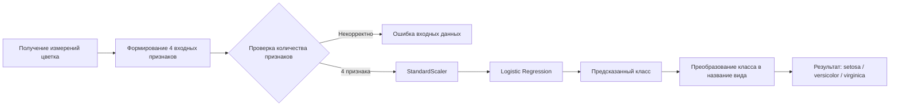

# Роль ML-модели в процессе Iris Classification

## 1. Схема процесса

Схема показывает место ML-модели в процессе классификации экземпляра Iris: от получения измерений до выдачи понятного пользователю названия класса.

    ## 2. Какую задачу решает модель

Модель решает задачу многоклассовой классификации.

На основании четырёх числовых характеристик цветка она определяет, к какому из трёх видов Iris относится объект:

- setosa;
- versicolor;
- virginica.

В техническом процессе модель является центральным компонентом этапа классификации. Остальные части процесса отвечают за подготовку входных данных, их проверку и представление результата.

## 3. Почему для этой задачи используется ML

Класс объекта зависит сразу от нескольких числовых признаков и их сочетания.

Вместо ручного задания большого количества порогов и правил модель обучается на размеченных примерах и определяет границы между классами на основании данных.

Для набора Iris задача достаточно проста и теоретически могла бы быть решена набором эвристических правил. Однако использование машинного обучения позволяет продемонстрировать универсальный подход к задаче классификации:

`размеченные данные → обучение модели → применение модели к новым объектам`

Этот подход масштабируется на более сложные прикладные задачи, где ручное описание всех правил становится затруднительным.

## 4. Какие данные поступают на вход модели

На вход модели поступают четыре числовых признака объекта:

1. `sepal length` — длина чашелистика;
2. `sepal width` — ширина чашелистика;
3. `petal length` — длина лепестка;
4. `petal width` — ширина лепестка.

Пример входных данных:

`[5.1, 3.5, 1.4, 0.2]`

Перед классификацией признаки проходят стандартизацию с помощью `StandardScaler`.

После этого подготовленные значения передаются в модель `LogisticRegression`.

## 5. Как используется результат модели

Модель возвращает числовой класс:

- `0` — setosa;
- `1` — versicolor;
- `2` — virginica.

Модуль `predict.py` преобразует числовой результат в название вида.

В текущей реализации результат выводится пользователю в виде:

`Predicted species: setosa`

В более широком техническом процессе результат классификации может быть передан следующему компоненту системы, например:

- пользовательскому интерфейсу;
- сервису хранения результатов;
- каталогу объектов;
- другому программному модулю, использующему результат классификации.

Таким образом, зона ответственности ML-модели ограничена преобразованием подготовленных входных признаков в прогноз класса, а дальнейшее использование результата находится за пределами самой модели.

## 6. Внутренний ML-процесс

Ниже показана последовательность обработки данных непосредственно внутри ML-компонента:

Масштабирование признаков и классификатор объединены в единый `sklearn Pipeline`.

Это позволяет использовать одинаковую последовательность преобразований как при обучении модели, так и при выполнении предсказаний.

## 7. Место модели в проекте

ML-модель является частью общего технического процесса, но не отвечает за весь процесс целиком.

Её роль можно представить следующим образом:

`входные данные → проверка и подготовка → ML-модель → предсказанный класс → использование результата`

Модель отвечает только за преобразование подготовленных признаков в прогноз класса.

Получение данных, проверка структуры входа, представление результата пользователю и возможная передача результата в другие системы относятся к другим компонентам проекта.

Такое разделение упрощает сопровождение системы: можно изменять источник данных или способ использования результата без изменения самой логики классификации.
