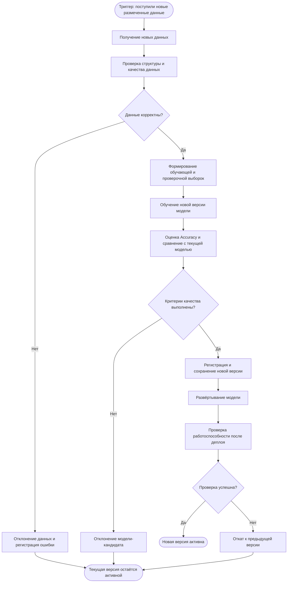

# Процесс автоматического переобучения модели Iris Classifier

## 1. Назначение процесса

Цель процесса — обеспечить автоматизированное обновление ML-модели Iris Classifier при появлении новых размеченных данных.

Модель решает задачу многоклассовой классификации цветков Iris по четырём числовым признакам с использованием алгоритма Logistic Regression.

Процесс переобучения должен обеспечивать:

- обнаружение события, требующего обновления модели;
- получение и проверку новых данных;
- обучение модели-кандидата;
- оценку качества новой версии;
- сравнение с действующей моделью;
- принятие решения о публикации;
- сохранение новой версии модели;
- развёртывание новой версии;
- сохранение предыдущей рабочей версии при ошибках.

В текущей реализации проекта доступно обычное обучение модели на встроенном датасете Iris и сохранение результата в файл `iris_model.joblib`.

Автоматическое переобучение, управление версиями моделей и деплой рассматриваются в данном документе как проектируемое расширение существующей системы.

## 2. Схема автоматического переобучения

Ниже представлен проектируемый процесс автоматического переобучения модели Iris Classifier — от поступления новых данных до публикации новой версии модели.

Схема предусматривает автоматическое обновление модели только при успешном прохождении проверок данных, качества предсказаний и работоспособности новой версии.

Если данные некорректны, качество новой модели не соответствует установленным критериям или развёртывание завершается ошибкой, действующая версия модели сохраняется.

## 3. Описание этапов процесса

В данном разделе описаны основные этапы проектируемого процесса автоматического переобучения Iris Classifier.

| № | Этап | Что происходит | Результат этапа |
|---|---|---|---|
| 1 | Триггер переобучения | Система обнаруживает поступление новой партии размеченных данных Iris. | Событие запуска процесса переобучения. |
| 2 | Получение данных | Загружаются новые измерения цветков и соответствующие метки классов. | Набор новых размеченных наблюдений. |
| 3 | Валидация данных | Проверяются наличие четырёх признаков, корректность числовых значений и допустимость меток классов. | Валидированные данные либо сообщение об ошибке. |
| 4 | Подготовка выборок | Новые данные объединяются с подходящими историческими наблюдениями. Формируются обучающая и валидационная выборки. | Подготовленные данные для обучения и оценки. |
| 5 | Обучение | Создаётся новая модель на основе Pipeline: StandardScaler + LogisticRegression. | Обученная модель-кандидат. |
| 6 | Оценка качества | Рассчитывается Accuracy новой модели. Результат сравнивается с действующей версией на одинаковой независимой проверочной выборке. | Метрики качества и результат сравнения моделей. |
| 7 | Решение о публикации | Проверяется соответствие установленным критериям качества. | Решение о принятии или отклонении модели-кандидата. |
| 8 | Регистрация версии | Для принятой модели создаётся уникальная версия, сохраняются модель, метрики и информация об обучении. | Зарегистрированная версия модели. |
| 9 | Развёртывание | Новая версия подготавливается к использованию вместо действующей модели. | Развёрнутый кандидат для финальной проверки. |
| 10 | Проверка после деплоя | Выполняется контрольное предсказание и проверяется корректность загрузки модели. | Результат проверки работоспособности. |
| 11 | Активация или откат | При успешной проверке новая версия становится активной. При ошибке восстанавливается предыдущая версия. | Активная работоспособная модель. |

### Обработка ошибок

Процесс предусматривает три основных сценария неуспешного выполнения:

1. **Ошибка данных.** Если новые данные не проходят валидацию, обучение не запускается. Ошибка регистрируется, текущая модель остаётся активной.
2. **Недостаточное качество.** Если модель-кандидат не соответствует критериям качества, она отклоняется и не передаётся на развёртывание.
3. **Ошибка развёртывания.** Если новая модель не загружается или не проходит контрольное предсказание, выполняется откат к предыдущей работоспособной версии.

Во всех трёх случаях существующая модель продолжает использоваться, а информация о причине отказа сохраняется для последующего анализа.

## 4. Критерии принятия новой модели

Перед публикацией новая версия Iris Classifier должна пройти автоматические проверки.

В проектируемом процессе предлагаются следующие критерии:

| № | Критерий | Условие успешного прохождения |
|---|---|---|
| 1 | Корректность данных | Все четыре признака присутствуют, имеют допустимые числовые значения, метки классов корректны. |
| 2 | Успешность обучения | Pipeline успешно обучен, критических ошибок нет. |
| 3 | Минимальное качество | Accuracy новой модели не ниже 0.90. |
| 4 | Сравнение с текущей моделью | Accuracy новой модели не ниже Accuracy действующей версии на одном и том же контрольном наборе данных. |
| 5 | Работоспособность | Модель успешно сохраняется, загружается и выполняет тестовое предсказание. |

### Правило публикации

Новая версия модели допускается к публикации только при выполнении всех перечисленных условий.

В текущем учебном проекте ранее получено:

**Accuracy = 0.933**

Это значение является результатом оценки существующей модели на тестовой выборке.

Для корректного сравнения действующая модель и модель-кандидат должны оцениваться на одной независимой контрольной выборке, которая не используется для обучения моделей.

### Пример принятия решения

**Сценарий 1.**

- Accuracy действующей модели: 0.933;
- Accuracy новой модели: 0.967;
- Проверки данных и работоспособности пройдены.

Решение: модель-кандидат допускается к регистрации и развёртыванию.

**Сценарий 2.**

- Accuracy действующей модели: 0.933;
- Accuracy новой модели: 0.900;
- Проверки данных и работоспособности пройдены.

Решение: модель-кандидат отклоняется, поскольку её качество ниже качества действующей версии.

**Сценарий 3.**

- Accuracy новой модели: 0.967;
- При загрузке сохранённой модели возникает ошибка.

Решение: публикация отклоняется, действующая модель остаётся активной.

### Ограничения критериев

Порог Accuracy >= 0.90 и правило сравнения с действующей моделью предложены для учебного проектируемого процесса. Они не являются уже реализованными механизмами текущего проекта.

Датасет Iris содержит всего 150 объектов, поэтому оценка качества на небольшой выборке может быть нестабильной.

В реальной ML-системе критерии публикации необходимо дополнительно обосновывать с учётом объёма данных, стоимости ошибок и особенностей предметной области.

## 5. Регистрация и развёртывание новой версии модели

Если модель-кандидат соответствует всем критериям качества, система переходит к регистрации и развёртыванию новой версии.

### 5.1. Регистрация версии

Для новой модели создаётся уникальный идентификатор версии, например:

- `v1.0` — действующая модель;
- `v1.1` — новая модель-кандидат;
- `v1.2` — следующая версия после переобучения.

В реестре моделей предлагается сохранять:

- идентификатор версии;
- дату и время обучения;
- версию обучающих данных;
- параметры модели;
- значение Accuracy на контрольной выборке;
- путь к сохранённому артефакту модели;
- статус версии: candidate, active или archived.

Обученная модель сохраняется в формате Joblib.

В текущем проекте используется файл `models/iris_model.joblib`. Для автоматического переобучения предполагается расширение механизма хранения с поддержкой нескольких версий.

**Результат этапа:** зарегистрированная модель-кандидат с уникальной версией, метриками и сохранённым артефактом.

### 5.2. Развёртывание модели

После регистрации новая версия передаётся на этап развёртывания.

Предполагается следующая последовательность:

1. Загрузка сохранённого артефакта модели-кандидата.
2. Подготовка модели к использованию в процессе предсказаний.
3. Проверка корректности загрузки Pipeline.
4. Выполнение контрольного предсказания на заранее подготовленном примере.
5. Проверка корректности возвращаемого класса.

Если проверки успешно пройдены, новая версия назначается активной и используется для последующих предсказаний.

Предыдущая работоспособная версия сохраняется для возможного восстановления.

**Результат этапа:** новая активная версия Iris Classifier, прошедшая проверку работоспособности.

## 6. Обработка ошибок и откат

В проектируемом процессе предусмотрен механизм сохранения работоспособности системы при неуспешном обновлении модели.

### 6.1. Ошибка при развёртывании

Если модель-кандидат не загружается, возвращает некорректный результат или не проходит контрольное предсказание:

1. Новая версия не назначается активной.
2. Ошибка регистрируется в журнале выполнения.
3. Действующая версия продолжает использоваться.
4. Неуспешной версии присваивается соответствующий статус.

### 6.2. Ошибка после активации

Если проблема обнаружена уже после переключения на новую модель:

1. Система обнаруживает сбой.
2. Выполняется переключение на предыдущую работоспособную версию.
3. Проверяется восстановление предсказаний.
4. Информация об ошибке сохраняется для анализа.

### 6.3. Итоговые состояния процесса

Процесс может завершиться одним из двух основных результатов:

**Успешное завершение:**

Новая модель прошла все проверки, зарегистрирована, развёрнута и назначена активной.

**Неуспешное завершение:**

Новая модель отклонена либо выполнен откат. Для предсказаний сохраняется или восстанавливается предыдущая работоспособная версия.

## 7. Связь с текущей реализацией проекта

В репозитории `iris-ml-production` уже реализованы:

- загрузка данных Iris;
- подготовка и разделение выборок;
- обучение Pipeline на основе StandardScaler и LogisticRegression;
- оценка Accuracy;
- сохранение модели через Joblib;
- загрузка модели и выполнение предсказаний;
- автоматические тесты с использованием pytest.

Для полноценной автоматизации описанного процесса дополнительно потребуются:

- механизм обнаружения новых размеченных данных;
- оркестрация запуска переобучения;
- автоматическая проверка качества данных;
- сравнение новой модели с действующей версией;
- реестр моделей и управление версиями;
- автоматическое развёртывание;
- механизм переключения версий и отката.

Таким образом, данный документ описывает проектируемый процесс автоматического переобучения, который может быть реализован как дальнейшее развитие существующего ML-проекта.
